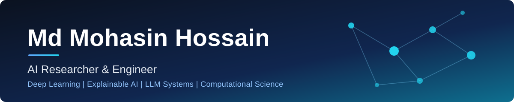

  

  
  

I research and build AI systems that can explain their decisions.

I work as a Research Assistant at the Interactive Machine Learning Lab at [DFKI](https://www.dfki.de) and am completing an M.Sc. in Bioinformatics at [Saarland University](https://www.uni-saarland.de), Germany. My work spans three areas: deep learning and explainable AI research, full-stack and LLM-based engineering, and computational biology, from molecular docking and dynamics simulations to genomic data analysis.

## Selected Research

<table>
  <tr>
    <td width="170" align="center" valign="middle">
        
      
    </td>
    <td valign="top">
      <b>Beyond Heatmaps: Unsupervised Concept-Graph Reasoning for Interpretable Visual Explanation</b> 
      Annotation-free concept discovery with NMF and graph attention reasoning for intrinsically interpretable image classification. 
      <a href="https://arxiv.org/abs/2607.01416">Paper</a> &nbsp;/&nbsp; <a href="https://sites.google.com/view/xai-workshop-ijcai-2026/proceedings">Proceedings</a> &nbsp;/&nbsp; <a href="https://github.com/mohasin-hossain/G-CBM">Code</a>
    </td>
  </tr>
  <tr>
    <td width="170" align="center" valign="middle">
        
      
    </td>
    <td valign="top">
      <b>Difenoconazole and isopyrazam antagonize thyroid hormone receptor α/β: comprehensive in vitro and in silico investigations</b> 
      In vitro assays combined with molecular docking and molecular dynamics simulations of fungicide-receptor binding. 
      <a href="https://lnkd.in/e74TbF6s">Paper</a>
    </td>
  </tr>
</table>

## Tech Stack

**Deep Learning & Research**

**Explainable AI**

**LLM & Agent Engineering**

**Full-Stack & Infrastructure**

**Computational Science**

 

  <b>Open to research collaborations, AI engineering roles, and conversations about interpretable ML and AI for science.</b>

  

